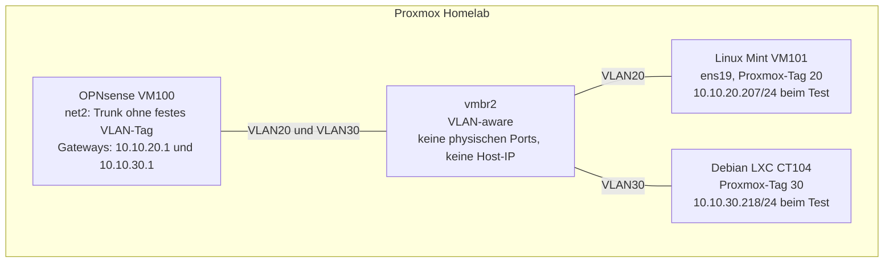

## VLAN-Segmentierung mit Proxmox und OPNsense

Dieses Homelab-Projekt zeigt die Einrichtung zweier VLANs, die automatische IP-Adressvergabe mit Dnsmasq und die Steuerung des Inter-VLAN-Verkehrs mit OPNsense. Ein Schwerpunkt war die systematische Fehlersuche bei der DHCP-Inbetriebnahme und bei den anschließenden Verbindungstests.

Die dokumentierten Tests bestätigen: Ping-Anfragen von VLAN20 nach VLAN30 sind erlaubt. Neue Ping-Anfragen von VLAN30 nach VLAN20 werden blockiert.

📄 **[Projektdokumentation als PDF ansehen](VLAN-Projektdokumentation.pdf)**

## Projektziele

- Zwei virtuelle IPv4-Netze durch VLANs voneinander trennen.
- OPNsense als Router und Firewall zwischen den Netzen einsetzen.
- IP-Adressen über DHCP vergeben.
- Fehler anhand von Routingtabellen, Paketmitschnitten, Portbelegung und Dienstlogs eingrenzen.
- Die vorgesehene ICMP-Regelung nach der DHCP-Umstellung erneut testen.

## Umgebung und Adressierung

| Komponente | Konfiguration |
|---|---|
| Proxmox-Bridge `vmbr2` | VLAN-aware, keine physischen Bridge-Ports, keine Host-IP |
| OPNsense VM100 | Netzwerkadapter `net2` an `vmbr2`, Trunk ohne festes VLAN-Tag |
| VLAN20 | `10.10.20.0/24`, Gateway `10.10.20.1` |
| Linux Mint VM101 | Gastinterface `ens19`, VLAN-Tag 20 in Proxmox, DHCP-Adresse beim Test: `10.10.20.207/24` |
| VLAN30 | `10.10.30.0/24`, Gateway `10.10.30.1` |
| Debian LXC CT104 | VLAN-Tag 30 in Proxmox, DHCP-Adresse beim Test: `10.10.30.218/24` |
| DHCP-Dienst | Dnsmasq auf OPNsense |
| DHCP-Bereich VLAN20 | `10.10.20.200` bis `10.10.20.220` |
| DHCP-Bereich VLAN30 | `10.10.30.200` bis `10.10.30.220` |

Die angegebenen Client-Adressen sind die beim Test verwendeten DHCP-Adressen und keine zugesicherten dauerhaften Zuweisungen. Zu Beginn wurden statische IP-Adressen verwendet; anschließend erfolgte die Umstellung auf DHCP.

## Netzwerkaufbau

Das Diagramm zeigt den VLAN-Lab-Aufbau. Der zusätzliche Mint-Adapter `ens18`, der bei der Routingdiagnose relevant war, ist hier nicht dargestellt.

## DHCP-Fehlersuche

Bei der DHCP-Inbetriebnahme trat ein Konflikt zwischen Kea und Dnsmasq um UDP-Port 67 auf. Zur Eingrenzung wurden folgende Werkzeuge genutzt:

- **tcpdump:** DHCP-Paketverkehr untersuchen.
- **sockstat:** den auf UDP-Port 67 lauschenden Dienst bestimmen.
- **Kea-Dienstlogs:** Fehler beim Dienststart beziehungsweise bei der Portbindung prüfen.

Nach dem Deaktivieren von Kea übernahm Dnsmasq die DHCP-Vergabe für beide VLANs. Die PDF dokumentiert die DHCP-Bereiche, die Client-Adressen und Dnsmasq als Listener auf UDP-Port 67. Historische Kea-Fehlerausgaben sind nicht enthalten.

## Routing und Firewall

Linux Mint besitzt zusätzlich den Netzwerkadapter `ens18`. Bei der Fehlersuche zeigte die Routingtabelle, dass Verkehr nach VLAN30 zunächst über diesen Adapter und das Gateway `10.10.10.1` lief. Für den VLAN-Test wurde eine vorübergehende Route zu `10.10.30.0/24` über `10.10.20.1` und `ens19` eingerichtet. Diese Route ist keine dauerhaft gespeicherte Netzwerkkonfiguration.

Ein weiterer Befund: Ping-Anfragen an das VLAN20-Gateway wurden durch die Standardsperre von OPNsense blockiert. Die Erreichbarkeit der Firewall selbst wurde deshalb getrennt vom weitergeleiteten Inter-VLAN-Verkehr untersucht.

Die Firewall unterscheidet neue Anfragen von Antwortverkehr innerhalb bestehender Zustände. Antworten auf erlaubte Pings aus VLAN20 können zurückkehren, während neue Ping-Anfragen aus VLAN30 nach VLAN20 blockiert werden.

## Testergebnisse nach der DHCP-Umstellung

| Prüfung | Ergebnis | Nachweis in der PDF |
|---|---|---|
| DHCP in VLAN20 | Mint erhielt `10.10.20.207/24` | Client-Adresse und DHCP-Bereich |
| DHCP in VLAN30 | CT104 erhielt `10.10.30.218/24` | Client-Adresse und DHCP-Bereich |
| ICMP VLAN20 → VLAN30 | Vier Antworten, kein Paketverlust | Freigaberegeln und Ping-Ausgabe |
| Neue ICMP-Anfragen VLAN30 → VLAN20 | Blockiert | Routingausgabe, Ping ohne Antworten und zugehörige Block-Logs |

Die Verbindungstests beziehen sich auf ICMP. Sie belegen keine vollständige Freigabe oder Sperre anderer Protokolle und keine produktive Betriebssicherheit.

## Erkenntnisse

- VLAN-Zuordnung, IP-Adressierung und Routing müssen zusammenpassen.
- Bei mehreren Netzwerkadaptern muss der tatsächliche Hin- und Rückweg geprüft werden.
- Ein fehlgeschlagener Ping allein beweist keine Firewall-Sperre; passende Logs helfen bei der Zuordnung.
- Die Prüfung von Paketfluss, Portbelegung und Dienstlogs ermöglicht eine gezielte DHCP-Diagnose.
- Nach Änderungen an der Adressvergabe müssen betroffene Verbindungstests wiederholt werden.
  
# Repository STRUKTUR
vlan-homelab/
├── README.md
└── VLAN-Projektdokumentation.pdf
